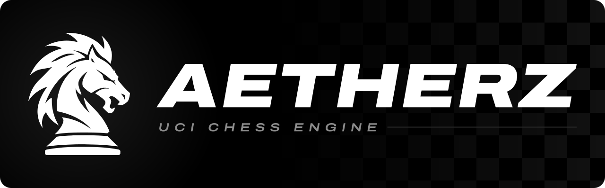

<p align="center">
  
</p>

<p align="center">
  
  
  
  
</p>

<p align="center">
  <b>Built to calculate. Trained on itself.</b><br>
  <sub>A fast UCI chess engine with a self-trained neural network, a modern alpha-beta search and perfect endgames.</sub>
</p>

<p align="center">
  <a href="#quick-start">Quick start</a> &nbsp;·&nbsp;
  <a href="#inside">Inside</a> &nbsp;·&nbsp;
  <a href="#uci-options">UCI options</a> &nbsp;·&nbsp;
  <a href="docs/DEVELOPMENT.md">Development</a>
</p>

<br>

## Quick start

```bash
git clone https://github.com/AdminGodZ/AetherZ.git && cd AetherZ
cmake -S . -B build -G Ninja && cmake --build build
./build/aetherz
```

Then load `build/aetherz` into any UCI GUI: Cute Chess, En Croissant, Arena or BanksiaGUI.

> [!TIP]
> Builds are tuned for the CPU they're built on. Pass `-DAETHERZ_NATIVE=OFF` for a binary that runs on other machines.

## Inside

<table>
  <tr>
    <th align="left" width="33%">Evaluation</th>
    <th align="left" width="33%">Search</th>
    <th align="left" width="33%">Endgames</th>
  </tr>
  <tr valign="top">
    <td>A <code>(768&nbsp;→&nbsp;256)×2&nbsp;→&nbsp;1</code> NNUE, trained only on AetherZ's own self-play games and built into the binary.</td>
    <td>Alpha-beta with aspiration windows, null-move pruning, late-move reductions, ProbCut, singular extensions and multithreading (Lazy SMP).</td>
    <td>Syzygy tablebases through Fathom: tablebase-perfect root moves and win/draw/loss probes inside the search.</td>
  </tr>
</table>

## UCI options

| Option | Default | |
| :-- | :-- | :-- |
| `Hash` | `32` | Transposition table size in MB |
| `Threads` | `1` | Search threads |
| `SyzygyPath` | — | Folders with Syzygy tables, separated by `:` (`;` on Windows) |
| `Move Overhead` | `30` | Milliseconds kept back per move for GUI and network lag |
| `EvalFile` | built-in | Path to a different NNUE network |
| `UseNNUE` | `true` | Set to `false` for the classical evaluation |

<details>
<summary>More options</summary>
<br>

| Option | Default | |
| :-- | :-- | :-- |
| `SyzygyProbeLimit` | `7` | Most pieces a position may have to be probed |
| `SyzygyProbeDepth` | `1` | Least depth at which the search probes the tables |
| `Syzygy50MoveRule` | `true` | Score wins that the fifty-move rule turns into draws as draws |
| `Ponder` | `false` | Think on the opponent's time |
| `Clear Hash` | | Empty the transposition table |

</details>

## Development

```bash
ctest --test-dir build --output-on-failure   # unit, perft and search tests
./build/aetherz bench                        # node-count signature of the search
```

Every commit that touches search quotes its bench node count, and strength changes are kept only after they win an SPRT match. The [development guide](docs/DEVELOPMENT.md) covers build options, the match runner, evaluation tuning and tablebases. [tools/nnue](tools/nnue/README.md) covers training networks.

<br>

<p align="center">
  <picture>
    <source media="(prefers-color-scheme: dark)" srcset="assets/logo/aetherz-mark-white.svg">
    
  </picture>
</p>
